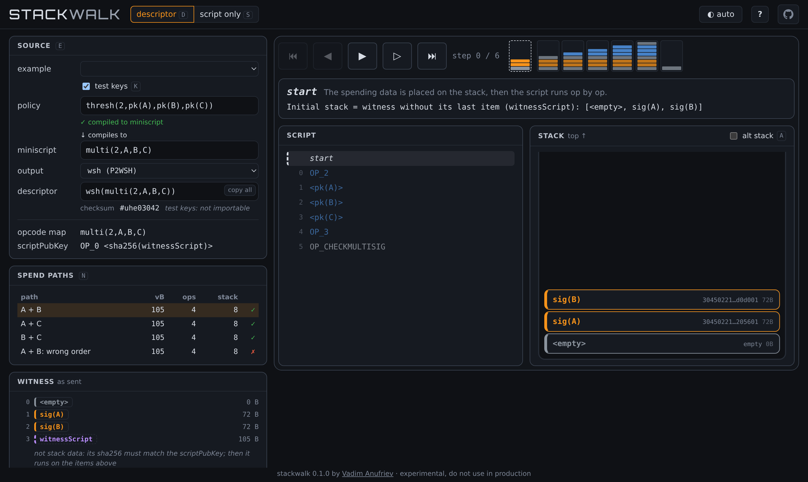

# stackwalk

Step through Bitcoin Script with the stack drawn at every opcode. Write a policy, miniscript or descriptor (or raw Script), pick a spend path, walk the run.



Live at [vadim.rs/stackwalk](https://vadim.rs/stackwalk/).

**Experimental, for learning.** The interpreter is not Bitcoin Core's. It passes all 1217 legacy and segwit v0 vectors of Core's `script_tests.json` (v31.1); taproot is not covered. Don't rely on it for real funds. It never needs private keys: don't paste them.

## Run

Needs stable Rust.

```sh
cd server
cargo run              # http://127.0.0.1:5173, reloads on changes in web/
cargo build --release  # one binary, the page embedded
cargo test
```

Settings, by environment: `BIND` - addresses to listen on, comma separated (default `127.0.0.1:5173`); `METRICS_BIND` - address for Prometheus `/metrics` (off by default; keep it private). For a public site put it behind a reverse proxy: the server has no header timeouts and no per-client rate limit. `deploy/` has example nginx and Prometheus configs.

## Notes

- `web/` is the page (plain JS modules, no build step), `server/` the backend (axum, rust-miniscript).
- Test keys: `A`, `B`, ... are fixed test keys; signatures are over a dummy transaction. Real keys are run as test keys of the same names.
- `server/src/scriptexec/` is vendored from [rust-bitcoin-scriptexec](https://github.com/BitVM/rust-bitcoin-scriptexec) (CC0) with local changes, listed in its `mod.rs`.
- PRs welcome; `cargo test`, `cargo clippy --all-targets` (in `server/`) and `node --test` (in the root) should pass.

## License

MIT or Apache-2.0, at your option. Exceptions (the vendored interpreter, the title font Orbitron, OFL) are in [LICENSE](LICENSE).
